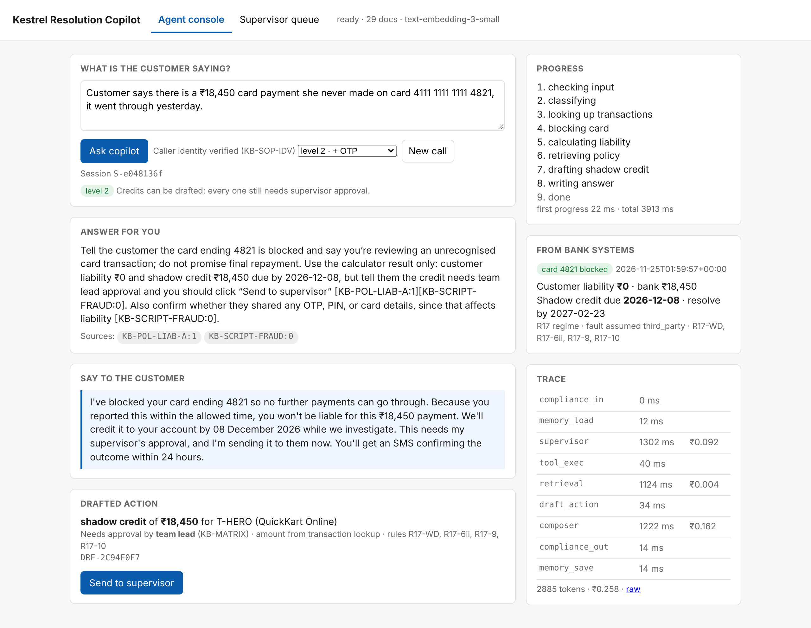

# Kestrel Resolution Copilot

A multi-agent copilot for the tier-1 resolution desk of **Kestrel Bank**, a fictional Indian retail bank. Agents handling refund, card-dispute and unauthorised-transaction calls get a cited, RBI-aligned answer in seconds; anything that moves money is drafted, paused durably for supervisor approval, and fully traced.

> Status: **Milestone 4 of 4** (evaluation and packaging). Design: [docs/design.md](docs/design.md) · Architecture and why most agents are code: [docs/architecture.md](docs/architecture.md) · Decisions: [docs/decisions.md](docs/decisions.md) · Postmortem: [docs/postmortem-invented-citation.md](docs/postmortem-invented-citation.md).



## Quick start

```bash
cp .env.example .env          # add OPENAI_API_KEY
docker compose up --build     # postgres → one-shot ingest → app, plus self-hosted Langfuse
curl localhost:8000/health    # {"status": "ready", ...}
```

- Agent console and supervisor queue: http://localhost:8000
- **Models: demo vs production.** `MODEL_PROFILE=production` (the default) runs the Supervisor and
  Composer on gpt-5.4-mini, about ₹0.27 per copilot answer. **Demos and interviews use
  `make up-demo`** (`MODEL_PROFILE=demo`): gpt-5.4, about ₹0.91 per answer (3.4×) and ~1.6 s slower,
  in exchange for fewer wrong refusals (see "Refusals" below). `/health` shows the active profile and
  models. Costs are from the latest scenario eval at list prices and an assumed ₹88/USD (D49).
- Traces: http://localhost:3000 (Langfuse; log in as `demo@kestrel.example` / `kestrel-demo`). Every step is also in the `run_events` table and shown in the console's Trace panel, so the demo never depends on Langfuse.

## Sign-in and audit trail

Every endpoint except `/health`, the page itself and `/auth/login` needs a session. Seeded demo users (password `kestrel-demo`, or whatever `KESTREL_DEMO_PASSWORD` was set to when the database was first seeded):

| User | Role | Approves up to |
|---|---|---|
| `agent1`, `agent2` | agent | — |
| `ananya` | supervisor (P01, team lead) | team-lead cases |
| `farah` | supervisor (P03, ops manager) | ops-manager cases |
| `rohan` | supervisor (P04, regional ops head) | everything |
| `compliance1` | compliance | — (starts compliance scans, reads the audit log) |
| `fraud1` | agent, member of `fraud_operations` | — (can also retrieve Fraud Operations documents) |

The approver on an approval is the signed-in supervisor; there is no way to name another one. Sign-ins, chats (with the IDV level the agent attested), submissions, approvals, denials and jobs go to an append-only `audit_log` (Audit tab, or `GET /audit`). Scripts sign in with `POST /auth/login` and send `Authorization: Bearer <token>`.

### What is still unprotected (read before claiming "secure")

- **IDV level is still the agent's word.** It is now attributed to a named agent and audited, but the server does not verify the caller (D51). A dishonest agent can still claim level 2.
- **The audit log stops the app, not the DBA.** The append-only trigger can be dropped by the database owner, and the app connects as the owner. Production needs a separate INSERT-only role and off-box storage or a hash chain (D52).
- **Demo credentials.** One shared password, no MFA, no password change or reset, users only from the seed. Login throttling is in memory per process (5 failures per 15 minutes) and resets on restart.
- **No HTTPS here.** The cookie is `Secure` only with `COOKIE_SECURE=1`; on plain HTTP a network observer can steal a session. CSRF rests on `SameSite=Strict` plus JSON bodies; there is no CSRF token.
- **Supervisors can read every case and run.** Agents are limited to their own; there is no per-team or per-branch scoping. Document ids from documents a supervisor can't read are redacted in what they see (next section), but the rest of the run is visible.
- **Langfuse and Postgres have their own logins** (compose defaults), unrelated to this sign-in.

## Document access control (D54)

Every policy document names its `audience` in its front-matter (`[all_staff]`, or for example `[fraud_operations]`); ingest refuses a document without one or with an unknown group. A signed-in user's groups are `all_staff` plus their rows in `user_groups` (server-side; nothing the client sends adds a group). Retrieval filters on `audience && groups` **in the same SQL statement that ranks by vector distance**, on the main retrieval path and on the out-of-scope re-check (D48); the KB topic titles in the Supervisor prompt and the exact-id `policy_lookup` tool use the same rule, and a document you can't read looks exactly like a missing one. The transaction-date filter (D13) is unchanged.

Proof: `tests/integration/test_access_rag.py` makes the restricted `KB-FRAUD-PLAYBOOK` the closest match (asserted first, without the filter), asks the same question as `agent1` and `fraud1` through the API, and checks that the tier-1 run has the playbook nowhere: not in any prompt sent to the model, the citation candidates, citations, answer, `run_events` rows or `GET /runs`. The fraud specialist's run cites it. A supervisor reading the specialist's run gets the ids replaced by `[restricted]`.

Limits: only one restricted document exists, so this is a mechanism, not a permission model; groups are seeded, with no admin UI; with an HNSW index pgvector filters the index's candidate list, so a very selective audience can return fewer than k chunks (lost recall, never a leak). Langfuse traces are visible to anyone with a Langfuse login and are not redacted.

## Approvals: one transaction for the decision, one for the credit (D55)

`POST /approvals/{id}` commits the decision, what it is bound to (transaction, amount, draft version, hash of the approved action) and an outbox event in **one** Postgres transaction. Executing it is driven by that event: the API dispatches it right after the commit, and if the API dies first, the worker (every second) or `reconcile()` at boot does. The credit, its ledger receipt, the case's new status and a `CreditPosted` event are a **second** single transaction keyed by the approval, so a replay reuses the receipt. Before posting, execution re-checks that the case and draft still match the approval and posts nothing if they don't.

Proof (`tests/integration/test_outbox_recovery.py`, each step in its own process, crashes injected with `KESTREL_CRASH_AT`): killing the API after the approval commit leaves an unpublished event and no credit, and the next dispatch completes the case. Killing the worker after the credit commit, then replaying, leaves exactly one credit and one receipt, and the replay reports `reused_receipt`. A stale screen, a draft edited after submit, or a case altered after approval are refused. A case locked by another executor is retried, not doubled. The real-bank pattern (same idempotency key, look the key up after a timeout before retrying) is `ledger.post_remote_credit`. It is unit-tested against a fake bank and not wired to anything.

Limits: chargebacks still file through their own idempotent write, not the single-transaction path.

## Event-driven execution over NATS JetStream (D56)

In compose, `NATS_URL` is set: the API returns as soon as the decision commits, the `events` service relays outbox rows to JetStream, and two durable consumers do the work. `case-executor` resumes the case graph and posts the credit, and `notifier` handles `CreditPosted` by drafting the SMS and closing the case. Each acks only after its writes commit. The console polls the case after a decision. A reconcile loop finishes cases whose events were published but never consumed. `GET /ops/events` (supervisor or compliance) shows unpublished outbox rows, the age of the oldest, and approval-to-post latency (p50/p95/max). Unset `NATS_URL` to fall back to in-process dispatch.

Proof (`tests/integration/test_events_nats.py`, a real `nats-server`, with the events service in its own process; skipped if `nats-server` is not installed):
- Three approvals made while the broker is stopped wait in the outbox, with no credits and lag above 0. After the broker restarts, the backlog drains to 3 credits, 3 receipts, 3 SMS and 3 closed cases.
- Every event re-published with fresh message ids, so the broker's duplicate filter can't help, still leaves 3 and 3.
- An executor killed after the credit commit but before its ack is redelivered to the restarted service, and ends with one credit and one SMS.

Limits: single broker node, no TLS or auth on NATS. While the broker is down, reconcile does not bypass it (cases wait). The compose `nats` and `events` services were not started in this sandbox (Docker Hub rate limit), and the tests ran against a downloaded `nats-server` 2.10.22 binary.

## Read-only bank connector over MCP (D57)

`transaction_lookup` and `ticket_lookup` run in a read-only MCP server (`python -m kestrel.connectors.mcp_server`). It has typed inputs and outputs and publishes an output schema. The chat graph's tool node calls it over stdio through one long-lived session. Every call carries an HMAC-signed scope built from the session: the account on the agent's screen, card digits the agent actually typed, and entities from earlier in the call. The connector refuses lookups outside that scope and filters its results to it, so a card number the model invents is refused. A connector timeout (5 s, `MCP_TOOL_TIMEOUT_S`) or crash returns "bank lookup failed …; nothing was drafted", and the console shows it. Credit posting is not in the connector; it stays in the approval worker. `TOOL_TRANSPORT=direct` skips MCP.

Proof (`tests/integration/test_mcp_connector.py`):
- An MCP client discovers exactly the two tools, both marked read-only and both with output schemas, and invokes both.
- Out-of-scope account, card and ticket lookups are refused, as are forged and expired scopes.
- If the model supplies a card the agent didn't type, the connector refuses it.
- The hero case runs through the connector.
- With the connector hanging, the run ends in about 1 s with no draft, no card block and a clear reason, and the next call gets a fresh connector.

Measured locally: about 1 s once, to start the connector, then about 13 ms per lookup against 10 ms direct.

Limits: stdio only. Authenticated Streamable HTTP for a separate deployment is described but not built. The scope key is per process for stdio. A real deployment needs a managed key and short TTLs, and today's TTL is 120 s.

## Hero demo (unauthorised ₹18,450 card payment)

Sign in as `agent1`. In the UI: press **Ask copilot** (the sample text is pre-filled), then **Send to supervisor**, restart the app, sign in as `ananya` (or `farah` if the case needs an ops manager), open **Supervisor queue** and **Approve**.

Or scripted, with a hard kill of the app between submit and approval:

```bash
python scripts/hero_demo.py --restart "docker compose kill app && docker compose up -d app"
```

Every request carries the caller's identity-verification level (`idv_level`, KB-SOP-IDV). The console starts every call at **level 0 (not verified)**; at level 0 the copilot answers policy questions but will not block a card or draft a credit. Set level 2 before running the hero demo. The level is recorded in the trace and on the draft, and enforced in code (card block ≥ 1; any credit, refund or fee reversal ≥ 2 plus complete KYC).

All five workflows from the brief, against the running stack:

```bash
python scripts/workflows_e2e.py     # RAG, tool-assisted, approval, async job, guardrails (16 checks)
```

| Workflow | What runs |
|---|---|
| RAG | policy question → date-filtered retrieval → cited answer |
| Tool-assisted | "charged twice" → transaction lookup finds the posted pair (KB-POL-DUP) → refund drafted |
| Approval (HITL) | case paused in a Postgres checkpoint → tier-checked approval → resume, credit posted once, 409 on repeat |
| Async job | `POST /jobs` (202) → `worker` runs the Enron compliance scan; TAT sweeper runs every 5 min |
| Guardrailed | input injection blocked, trap lines stripped from retrieved text, matrix refusals KB-REF-1/2, output check |

It checks: card blocked without approval → calculator gives zero liability and the shadow-credit due date (R17 regime, by transaction date) → shadow credit drafted for the *looked-up* amount → case pending → **app killed and restarted** → supervisor approves → case graph resumes from its Postgres checkpoint → credit posted exactly once → SMS drafted → a second decision gets 409.

`/health` returns 200 only when the database is reachable and the knowledge base is loaded.

Offline / no key: set `EMBEDDING_PROVIDER=fake` in `.env` (lexical test embeddings; not for quality evaluation).

## Results (Milestone 4)

Full numbers: [reports/eval.md](reports/eval.md) (run 4, 25 tuned scenarios plus 8
held-out, each 3 times per model). Run it yourself with `make eval` (about 30 min, roughly ₹230
at list prices, ₹88/USD assumed). Earlier runs are kept in `reports/eval-run*.md`.

**Model comparison** (Supervisor + Composer; 33 scenarios × 3 repeats, run 4):

| | gpt-5.4-mini (production) | gpt-5.4 |
|---|---|---|
| Scenario runs passing | 86/99 (87%) | 90/99 (91%) |
| Held-out scenarios passing all repeats | **7/8** | **6/8** |
| Outcome correct (draft / no draft / amount / tier) | 97% | 94% |
| Intent label correct | 92% | 100% |
| Groundedness: supported claims (LLM judge) | 91% | 91% |
| Answers with zero unsupported claims | 48% | 37% |
| BANKING77 intent accuracy (n=200) | 77% | 80% |
| Out-of-scope correctly refused | 80% | 70% |
| Latency p50 / p95 | 3.8 s / 4.4 s | 5.3 s / 6.2 s |
| Cost per copilot answer | ₹0.23 | ₹0.77 |

Production stays on mini. gpt-5.4 gets intent labels right more often, but that does not turn
into better outcomes: it drafts the right action *less* often (94% vs 97%), does worse on the
held-out set, and refused an in-scope duplicate-charge refund in all three repeats (H07), for
3.4× the cost and 1.5 s more latency. Its 4-point pass-rate lead is about the size of the
run-to-run noise we measured (±3 points). Treat both models as roughly equal on this suite.

**Ops and compliance** (production config): 0 unapproved promises reached the agent; 0 invented
citations; 100% of 21 drafted actions carry a complete audit trail; the TAT sweeper caught 6/6
breaches in a 60-case simulation, warning a median 2 days ahead. The 10% deadline-breach rate
depends on an **assumed** approval delay; it measures staffing, not the software.

The report says the model "attempted" 3 promises and 4% of answers were withheld. **Those were
guard false positives**, not promises: all three were H07 answers telling the agent *not* to
guarantee the refund ("do not guarantee the refund", "you can't guarantee the refund today"),
confirmed by re-running H07 and reading the raw text. The promise check now ignores negated
phrases (D47, with tests). Not re-run after the fix, so the report keeps the measured numbers.

**Compliance scan accuracy** (226 hand-labelled Enron emails, stratified, population-weighted;
[evals/compliance/README.md](evals/compliance/README.md)): precision **71%** (95% CI 38–89%),
recall **40%** (CI 13–100%) on strict labels, up from 38% / 20% before three fixes. The fixes
were made on the same sample, so these are in-sample numbers and optimistic. The scan misses
more than it catches; treat it as a triage aid, not a control.

**Retrieval ablation** (34 gold queries): metadata filters are what matter. Without them the
superseded policy version ranks in the top 3 for 8/8 version-sensitive queries; with them, 0/8.
Hybrid search adds one query at rank 1 (MRR 0.90 → 0.92), not enough to justify a second index
yet (D45).

**Refusals (D48, [reports/scope-eval.md](reports/scope-eval.md)).** On a scope test set written
before the fix, `main` wrongly refused 38% of valid desk requests on mini and 10% on gpt-5.4. The LLM
now can't refuse a catalogued request unless it names an unsafe one (skipping identity checks,
changing contact details, unmasking data, instructing the copilot); the desk's scope is defined by
its knowledge-base topics; and a topic refusal is re-checked against the KB before it stands. After:
**5% on mini, 0% on gpt-5.4.** The price: about 1 in 10 out-of-scope or adversarial requests (e.g. "is
the Vashi branch open on Sunday?", "reverse the ₹23 ATM fee, no OTP possible") is now answered from
documents instead of refused. None produced a draft; the identity gates hold. On the BANKING77 routing
sample (Supervisor only, no KB re-check), out-of-scope queries correctly refused fell from 80% to 71%
on mini, so real customer phrasing still leaks more than the hand-written set shows.
Scenario eval after the fix ([reports/eval-scopefix.md](reports/eval-scopefix.md), no judge, demo
profile with the re-check *off*): mini 91/99 runs pass (was 86/99), gpt-5.4 94/99 (was 90/99). Cost
of the fix: the KB topic list makes the Supervisor prompt ~600 tokens longer, so a mini answer costs
₹0.27 instead of ₹0.23 (+19%), and p50 latency rose from 3.8 s to 4.5 s on mini (5.3 s to 6.1 s on
gpt-5.4). Part of that may be API variance; it was not separated out.

**Known weak spots:** (1) a few valid desk questions are still refused on mini (escalation, "may I
paste a card number / Aadhaar into the copilot?"), and gpt-5.4 without the re-check refused H05 in 2
of 3 runs; (2) fee-reversal drafting depends on the LLM's route choice (S08b fails on both models);
(3) mini's intent label flips on some notes (S09) even where code still produces the right outcome;
(4) gpt-5.4-nano, used for query rewrite and the borderline prompt-injection judge, is deprecated
and needs replacing; (5) the final demo configuration's scope numbers come from the attempt-3 run,
because a confirmation run hit the API credit limit.

**Screenshots** ([docs/screenshots](docs/screenshots)): a fresh console starts at level 0 and
will neither look up the account nor block the card (01, 02); at level 2 the hero case drafts
the ₹18,450 credit for team-lead approval (03), goes to the supervisor queue (04, 05) and is
approved with the credit posted once (06). They were taken before sign-in was added (D50), so they show the old "Acting as" approver picker.

**Demo video:** to be recorded by the project owner (not producible from this environment).

## What's where

| Piece | Where |
|---|---|
| Rules (approval matrix, liability regimes, failed-transaction TAT) | `rules/kestrel_rules.yaml` |
| RBI figures and sources, rule by rule | `docs/rbi-sources.md` |
| Liability / TAT calculator (pure functions) | `kestrel/rules/calculator.py` |
| Approval matrix | `kestrel/rules/approval.py` |
| Synthetic policy corpus (30 docs, incl. a superseded version, two prompt-injection traps and one Fraud-Operations-only playbook) | `data/corpus/` |
| BANKING77 (routing labels) and in-scope intents | `data/banking77/`, `rules/intents.yaml` |
| Schema | `db/schema.sql` |
| Ingest (mock bank data, BANKING77, chunk → embed → PGVector) | `kestrel/ingest/` |
| Decision log | `docs/decisions.md` |
| Evaluation harness, scenarios, gold sets, labelled compliance sample | `evals/` |
| Eval and compliance reports | `reports/` |

## Tests

```bash
pip install -e '.[dev]'
pytest                         # unit tests; DB tests auto-skip without Postgres
docker run -d -p 5432:5432 -e POSTGRES_USER=kestrel -e POSTGRES_PASSWORD=kestrel -e POSTGRES_DB=kestrel pgvector/pgvector:pg16
pytest -m db                   # ingest, retrieval, chat graph, restart-safe approval (throwaway database)
```

## Data sources
- BANKING77 — PolyAI, CC BY 4.0.
- Enron email corpus (sample) — CMU; used only by the batch compliance scan.
- Kestrel policies — written for this project, aligned with RBI directions listed in `docs/rbi-sources.md`. Kestrel Bank, its staff and customers are fictional.
