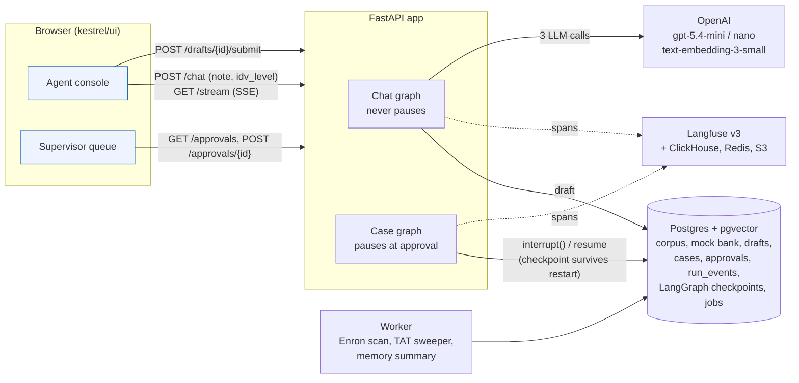
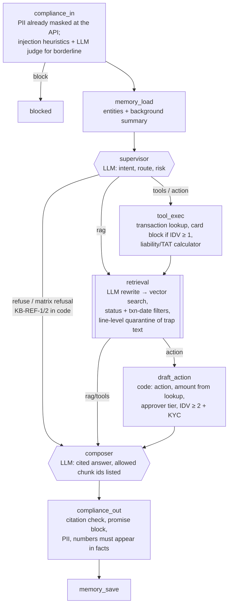

# Architecture

Kestrel Resolution Copilot is two LangGraph graphs on one Postgres, behind a FastAPI app,
with a worker for background jobs and self-hosted Langfuse for traces.

## Chat graph (one run per agent message)

Double boxes call an LLM; everything that touches money, dates or permissions is code.

## Case graph (one per submitted draft)

`submit` → `request_approval` (writes the approval row with ₹ tier and RBI due date, then
`interrupt()`) → *process may die here; the checkpoint is in Postgres* → supervisor decides
via `POST /approvals/{id}` (server checks the approver's tier; a second decision gets 409) →
`execute_action` (posts the credit once: unique index per transaction) → `notify` (SMS draft).
`reconcile()` at boot resumes any case whose approval was decided while the app was down.

## Why only three LLM calls ("why some agents are code")

The brief names seven agent roles. Four of them (compliance, approval, memory, tool execution)
are deterministic code here, because each one either moves money, computes a regulatory
date, or enforces a permission, and in each of those a wrong answer is a regulatory breach,
not a bad sentence. Code is testable with a table of cases (`tests/unit/test_calculator.py`),
gives the same answer every time, and costs nothing per call. The LLM is used where language
is the problem: classifying a messy agent note (Supervisor), turning it into a search query
(rewrite), and writing a short cited answer (Composer).

The evaluation supports this only partly, and the limit matters. No failing scenario had a
wrong *calculation*: given the inputs, the amount, the due date and the approver tier were
always right. But the inputs are not all code. The Supervisor's intent and its extracted flags
decide *which* calculation runs, and in eval run 1 that steered money twice: an LLM-set
"customer at fault" flag with no evidence in the note (S24) changed the liability outcome, and
an ATM cash-not-dispensed note classified as fraud (S09) would have blocked a card and applied
the fraud-liability rule to a failed debit. Both are now overridden in code (the fault flag
needs matching text in the note; a `failed_debited` transaction is never treated as fraud,
D42, D43). The honest claim is narrower: code computes every number, but an LLM still chooses
between code paths, and each such choice needs its own deterministic cross-check against bank
data. See `reports/eval.md` for the remaining routing failures (S08b, S09 intent label).

The trade-off: the deterministic graph handles only the intents it was built for. A new
dispute type needs code, not a prompt change. For a regulated desk that is the right default.
